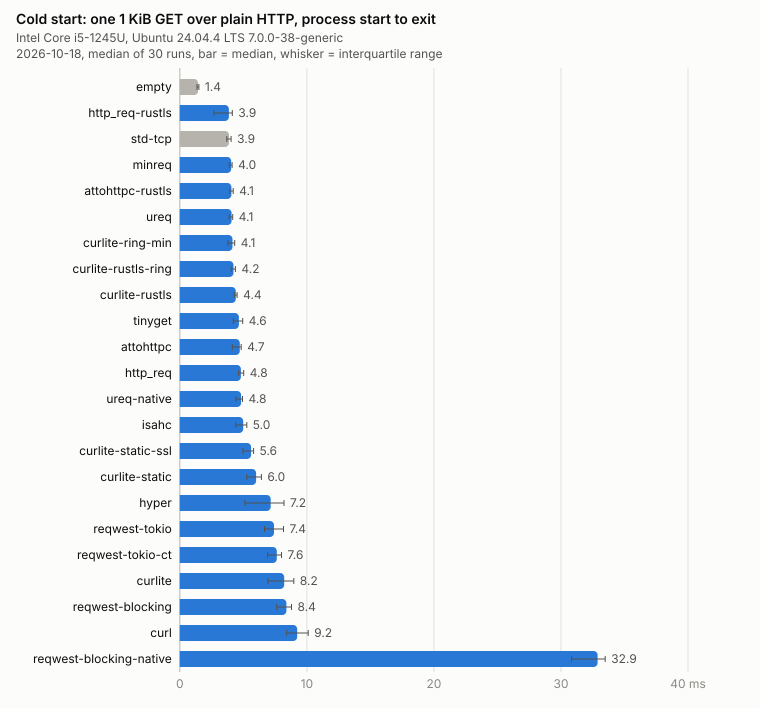
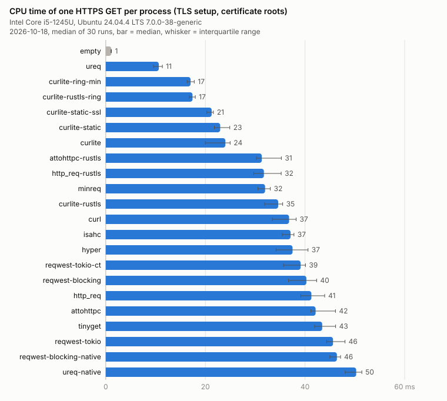
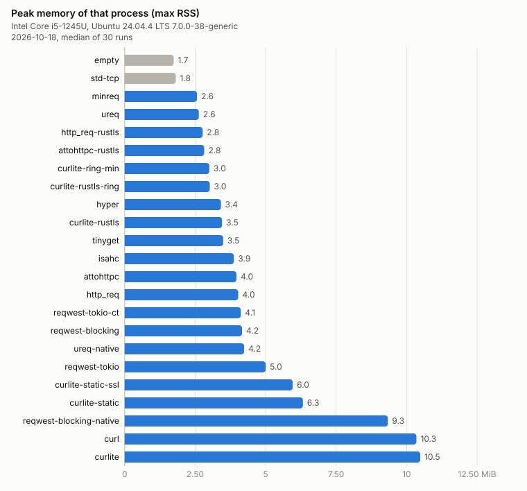
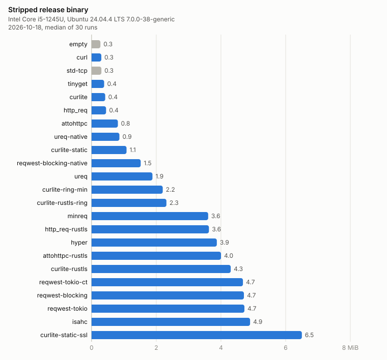
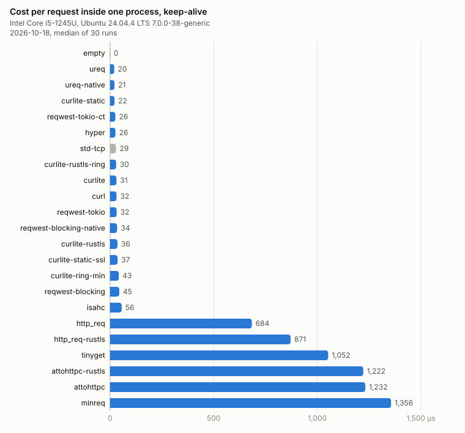

# Rust HTTP clients, measured per process

How much an HTTP client crate costs a process that starts, makes one
request and exits. CLI tools, cron jobs, git hooks and build scripts work
like that, and for them requests per second is the wrong number. What
matters is what the dependency adds to binary size, start time, memory,
the first HTTPS request and compile time.

Nineteen client builds run the same 15-line program (`GET <url> [-n count]`,
print status and byte count) with the same release profile against a local
keep-alive server. Two rows have no HTTP library at all: an empty Rust
binary and a hand-written request on `std::net::TcpStream`. They show where
the floor is. Each client is used with its default features, configured
the way its README suggests.

<picture>
  <source media="(prefers-color-scheme: dark)" srcset="docs/laptop-x86_64-cold_ms-dark.svg">
  
</picture>

## Findings

<!-- findings:laptop-x86_64 start -->
From the laptop run below. 30 processes per cell, medians.

- Most of the cost is the process itself. An empty Rust binary takes
  1.4 ms and 1.8 MiB, one hand-written request on `std::net` 3.9 ms.
  ureq, minreq, http_req, attohttpc and the static curlite builds start in
  3.9 to 4.4 ms, so within a millisecond of the floor. hyper and reqwest
  take 7 to 8 ms, mostly the runtime. Anything linked against the distro's
  shared libcurl takes 8 to 9 ms, because the loader has to map its 30-odd
  shared libraries first.
- Peak memory depends on the TLS library, not on the client. rustls builds
  peak at 2.6 to 3.5 MiB, native-tls on the system OpenSSL at 3.6 to
  4.4 MiB, a static libcurl on OpenSSL at 6 MiB, the distro libcurl at
  10.6 MiB. With ten processes running at once most of that is shared
  pages: 0.3 to 0.6 MiB private per rustls process, 1.8 MiB per
  distro-libcurl process.
- The first HTTPS request is where the clients really differ, and it comes
  down to the crypto backend. rustls on ring needs 11 ms of CPU in ureq and
  17 ms in curlite. rustls on aws-lc, which is what reqwest, hyper, minreq,
  attohttpc, http_req and isahc get by default, needs 31 to 46 ms.
  native-tls on OpenSSL needs 41 to 50 ms, most of it spent parsing the CA
  bundle. libcurl on OpenSSL can look roots up by hash instead of parsing
  the bundle, which is why curlite's OpenSSL rows are at 21 to 24 ms.
- reqwest with native-tls pays for TLS on every start, even for plain
  `http://`: 33 ms against 8 ms with rustls. The connector loads the
  certificate store when the client is built, not when a TLS connection
  needs it.
- minreq, attohttpc and http_req open a new connection for every request.
  In a loop that is 0.7 to 1.4 ms per request, against 20 to 56 µs for the
  clients that keep the connection. For one request per process it does
  not matter.
- You get either a small binary or no OpenSSL dependency. The builds that
  link the system OpenSSL are 0.3 to 0.9 MiB stripped. The rustls builds
  carry their own crypto and root store and are 1.9 MiB (ureq) to 5 MiB
  (isahc).
- Compile time follows the crate count. A clean release build takes 4 s for
  the `curl` crate and 7 s for curlite on the shared libcurl, 22 s for ureq,
  50 to 66 s for reqwest, and 45 to 107 s for the builds that compile
  libcurl or OpenSSL from source.
<!-- findings:laptop-x86_64 end -->

Two commands reproduce all of this on your own machine, see [Run it
yourself](#run-it-yourself). How each column is measured and what the
numbers do not tell you is in [METHODOLOGY.md](METHODOLOGY.md).

## Results: x86_64 laptop

<!-- results:laptop-x86_64 start -->
| client | TLS | crates | binary KiB | clean build s | cold start ms | max RSS KiB | per request µs | 8 MiB download RSS KiB | PSS of 10 procs KiB | HTTPS CPU ms | HTTPS RSS KiB |
|---|---|---|---|---|---|---|---|---|---|---|---|
| `empty` | none | 0 | 281 | 2 | 1.4 | 1,780 | 0 | 1,768 | 220 | 1 | 1,784 |
| `http_req-rustls` | rustls / aws-lc | 25 | 3,716 | 35 | 3.9 | 2,834 | 871 | 11,688 | 4,222 | 32 | 4,648 |
| `std-tcp` | none | 0 | 311 | 2 | 3.9 | 1,856 | 29 | 9,840 | 1,717 | - | - |
| `minreq` | rustls / aws-lc | 12 | 3,691 | 32 | 4.0 | 2,628 | 1,356 | 12,416 | 3,342 | 32 | 4,440 |
| `attohttpc-rustls` | rustls / aws-lc | 54 | 4,098 | 31 | 4.1 | 2,888 | 1,222 | 10,848 | 3,823 | 31 | 5,032 |
| `ureq` | rustls / ring | 27 | 1,928 | 22 | 4.1 | 2,692 | 20 | 11,004 | 6,111 | 11 | 4,500 |
| `curlite-ring-min` | rustls / ring | 36 | 2,253 | 58 | 4.1 | 3,076 | 43 | 11,104 | 3,605 | 17 | 4,624 |
| `curlite-rustls-ring` | rustls / ring | 36 | 2,369 | 35 | 4.2 | 3,090 | 30 | 11,196 | 3,645 | 17 | 4,672 |
| `curlite-rustls` | rustls / aws-lc | 35 | 4,405 | 45 | 4.4 | 3,536 | 36 | 11,352 | 4,245 | 35 | 5,892 |
| `tinyget` | OpenSSL (native-tls) | 17 | 398 | 8 | 4.6 | 3,576 | 1,052 | 11,484 | 6,981 | 43 | 9,048 |
| `attohttpc` | OpenSSL (native-tls) | 53 | 834 | 11 | 4.7 | 4,060 | 1,232 | 12,200 | 7,248 | 42 | 9,588 |
| `http_req` | OpenSSL (native-tls) | 20 | 460 | 9 | 4.8 | 4,124 | 684 | 13,080 | 7,839 | 41 | 9,216 |
| `ureq-native` | OpenSSL (native-tls) | 35 | 881 | 16 | 4.8 | 4,340 | 21 | 12,600 | 10,531 | 50 | 10,796 |
| `isahc` | rustls / aws-lc | 94 | 5,018 | 55 | 5.0 | 3,968 | 56 | 11,860 | 6,057 | 37 | 6,024 |
| `curlite-static-ssl` | OpenSSL | 20 | 6,658 | 107 | 5.6 | 6,104 | 37 | 14,252 | 12,523 | 21 | 8,452 |
| `curlite-static` | OpenSSL | 20 | 1,107 | 28 | 6.0 | 6,474 | 22 | 14,504 | 10,239 | 23 | 8,524 |
| `hyper` | rustls / aws-lc | 43 | 3,965 | 39 | 7.2 | 3,496 | 26 | 12,064 | 7,351 | 37 | 5,268 |
| `reqwest-tokio` | rustls / aws-lc | 94 | 4,839 | 66 | 7.4 | 5,122 | 32 | 13,576 | 12,231 | 46 | 6,600 |
| `reqwest-tokio-ct` | rustls / aws-lc | 94 | 4,793 | 60 | 7.6 | 4,218 | 26 | 12,640 | 8,331 | 39 | 5,916 |
| `curlite` | OpenSSL | 20 | 432 | 7 | 8.2 | 10,736 | 31 | 18,372 | 18,284 | 24 | 13,176 |
| `reqwest-blocking` | rustls / aws-lc | 95 | 4,823 | 64 | 8.4 | 4,262 | 45 | 12,652 | 8,700 | 40 | 5,964 |
| `curl` | OpenSSL | 7 | 310 | 4 | 9.2 | 10,596 | 32 | 18,320 | 18,123 | 37 | 13,420 |
| `reqwest-blocking-native` | OpenSSL (native-tls) | 93 | 1,556 | 27 | 32.9 | 9,562 | 34 | 18,008 | 29,439 | 46 | 10,076 |

Intel Core i5-1245U, Ubuntu 24.04.4 LTS 7.0.0-38-generic; 2026-10-18; rustc 1.99.0 (b940084d7 2026-09-28); runs=30, in-process requests=300; HTTPS against `https://example.com/`; libcurl libcurl 8.5.0.

<details><summary>Crate versions</summary>

attohttpc: attohttpc 0.31.0; attohttpc-rustls: attohttpc 0.31.0; curl: curl 0.4.51; curlite: curlite 0.2.1; curlite-rustls: curlite 0.2.1; http_req: http_req 0.14.6; http_req-rustls: http_req 0.14.6; hyper: http-body-util 0.1.5, hyper 1.12.0, hyper-rustls 0.27.10, hyper-util 0.1.21, tokio 1.53.3; isahc: isahc 2.0.1; minreq: minreq 3.0.0; reqwest-blocking: reqwest 0.13.5; reqwest-blocking-native: reqwest 0.13.5; reqwest-tokio: reqwest 0.13.5, tokio 1.53.3; reqwest-tokio-ct: reqwest 0.13.5, tokio 1.53.3; tinyget: tinyget 1.1.4; ureq: ureq 3.4.2; ureq-native: ureq 3.4.2; curlite-ring-min: curl 0.4.51, curlite 0.2.1; curlite-rustls-ring: curl 0.4.51, curlite 0.2.1; curlite-static: curlite 0.2.1; curlite-static-ssl: curlite 0.2.1

</details>
<!-- results:laptop-x86_64 end -->

<picture>
  <source media="(prefers-color-scheme: dark)" srcset="docs/laptop-x86_64-https_cpu_ms-dark.svg">
  
</picture>

<picture>
  <source media="(prefers-color-scheme: dark)" srcset="docs/laptop-x86_64-cold_rss_kb-dark.svg">
  
</picture>

<picture>
  <source media="(prefers-color-scheme: dark)" srcset="docs/laptop-x86_64-binary_kb-dark.svg">
  
</picture>

<picture>
  <source media="(prefers-color-scheme: dark)" srcset="docs/laptop-x86_64-req_us-dark.svg">
  
</picture>

## Results: GitHub Actions runner, refreshed weekly

The [`bench` workflow](.github/workflows/bench.yml) runs the whole thing
every Monday on `ubuntu-latest` and commits the result here. Runners are
shared hardware, so take the timing columns as a ranking rather than as
exact values. Binary size, crate count and build time are exact.

<!-- results:ci-ubuntu-x86_64 start -->
(no CI run yet)
<!-- results:ci-ubuntu-x86_64 end -->

## The clients

| row | crate and features | notes |
|---|---|---|
| `empty` | none | the process itself: exec, loader, libc, std |
| `std-tcp` | none | HTTP by hand on `std::net`, no TLS |
| `ureq` | ureq 3, default (rustls on ring, webpki roots) | the usual blocking client |
| `ureq-native` | ureq 3, `native-tls` | same, on OpenSSL |
| `minreq` | minreq 3, `https` (rustls) | minimal blocking client |
| `tinyget` | tinyget 1, `https` (native-tls) | minreq fork, smaller |
| `attohttpc` | attohttpc 0.31, default (native-tls) | blocking client built on the `http` types |
| `attohttpc-rustls` | attohttpc 0.31, `tls-rustls-webpki-roots` | same, on rustls |
| `http_req` | http_req 0.14, default (native-tls) | small blocking client |
| `http_req-rustls` | http_req 0.14, `rust-tls` | same, on rustls |
| `curl` | curl 0.4, default | the `curl` crate's `Easy` handle on the distro's shared libcurl |
| `curlite` | curlite 0.2, default | thin API over the distro's shared libcurl |
| `curlite-rustls` | curlite 0.2, `rustls` | libcurl compiled in, TLS from rustls, no OpenSSL |
| `isahc` | isahc 2, default (static libcurl, rustls, HTTP/2) | libcurl behind an async-capable API |
| `reqwest-blocking` | reqwest 0.13, default + `blocking` | the de-facto standard, blocking API |
| `reqwest-blocking-native` | reqwest 0.13, `blocking` + `native-tls` | same, on OpenSSL |
| `reqwest-tokio` | reqwest 0.13 + `#[tokio::main]` | the async client on the default multi-thread runtime |
| `reqwest-tokio-ct` | reqwest 0.13 + `#[tokio::main(flavor = "current_thread")]` | same, on a single-thread runtime |
| `hyper` | hyper 1, hyper-util `client-legacy`, hyper-rustls | what reqwest is built on, used directly |

`extra/curlite-matrix` has four more curlite builds (rustls on ring, HTTP-only
libcurl, static libcurl on the system OpenSSL, static libcurl and OpenSSL).
They need a patched `curl` crate, so they live in their own workspace where
the patch cannot leak into the other clients. They show up in the tables
like everything else.

## Run it yourself

```sh
# Debian/Ubuntu: what the clients that compile libcurl or link OpenSSL need
sudo apt install build-essential cmake pkg-config libssl-dev libcurl4-openssl-dev

python3 -I bench.py --https https://example.com/ --label mymachine   # builds, then measures
python3 -I report.py results/mymachine.json                          # charts and tables
```

`bench.py --help` lists the options: number of runs, the in-process request
count, `--build-time` for the compile-time column, `--parallel N` for the
summed memory of N concurrent processes, `--workspace extra/curlite-matrix`
for the extra builds. Results land in `results/<label>.json` with every raw
sample. `report.py` turns a result file into the SVG charts under `docs/`
and refreshes the README block with the matching label. Plain Python, no
dependencies.

## Earlier runs

[`results/archive/`](results/archive/) has the tables from the first version
of this benchmark, among them a run on an Orange Pi Zero 2W (Cortex-A53).
There cold starts take four to ten times longer and the gap between TLS
stacks grows to hundreds of milliseconds. I want to repeat that run with the
current set of clients.

## Adding a client

Copy a directory under `clients/`, keep the program the same, and use the
crate's default features plus whatever the variant needs. A client that
cannot do something (TLS, say) exits with code 3 and gets a `-` in that
column. If a client is configured worse than its README recommends, that is
a bug here, and a PR fixing it is welcome. The idea is to measure what a
user gets, not the leanest build anyone can come up with.

## License

MIT OR Apache-2.0, see [LICENSE-MIT](LICENSE-MIT) and
[LICENSE-APACHE](LICENSE-APACHE).
